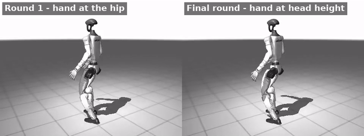

# Nemotron Reward Engineer

**Type a skill in plain English. An AI agent writes the reinforcement-learning reward, trains a Unitree G1 humanoid, watches the result, and rewrites the reward until the robot gets it right.**

Built for the **Nebius × NVIDIA Global AI Hackathon 2026 — Physical AI track**.



▶ **Demo page:** https://vishwavenkatesh.github.io/nemotron-reward-engineer/
▶ **Video:** _YouTube link_

---

## Why

Reward design is the slowest part of robot learning. A researcher writes a reward, trains for an hour, watches the video, sees the robot doing something silly, and edits the reward again. This project hands that whole loop to NVIDIA Nemotron models: one writes the code, one watches the robot, and the loop runs on its own.

## How it works

```
"raise the right hand above the head and wave while walking"
        │
        ▼
Nemotron Nano + Tavily ── search how researchers reward this kind of skill
        │
        ▼
Nemotron 3 Ultra ── writes a JAX reward module (SCALES + extra_rewards)
        │             └─ compile check in the real env; errors → Nemotron Nano repairs (Ultra if Nano fails)
        ▼
PPO fine-tune in MuJoCo MJX (Brax), starting from a G1 walk + reach policy
        │
        ▼
Rollout ── video, 6 key frames, measured hand positions, per-term reward means
        │
        ▼
Nemotron 3.5 Super-VL ── watches the frames + numbers, scores 0–10, explains what is wrong
        │
        └──► back to Ultra, which rewrites the reward. The next round continues from the best checkpoint so far.
```

Design details that made it work:

- **Web research first.** Nemotron Nano turns the skill into search queries and Tavily finds how researchers reward similar skills. Ultra gets the findings and notes in code comments which ideas it used.
- **Grounded geometry.** Before writing any reward, the agent measures the robot's body in simulation (shoulder height, arm length, highest reachable hand height, head height) and gives these numbers to Ultra. Without them, Ultra guessed targets that were only shoulder-high.
- **Numbers + vision for the critic.** The robot often faces the camera, so left and right are mirrored in the image. The critic receives exact hand positions from the simulator alongside the frames.
- **Self-repair with model routing.** Generated code is compiled in the real environment before any GPU time is spent. Compile errors go to Nemotron Nano first (a quick fix rarely needs the biggest model), and back to Ultra if Nano fails (e.g. it once used `jp.sigmoid`, which does not exist, and fixed it on the next attempt).
- **Curriculum by checkpoint chaining.** Each round fine-tunes from the best round so far, so progress accumulates instead of restarting.

## NVIDIA models used (all through Nebius Token Factory)

| Model | Role |
|---|---|
| `nvidia/Nemotron-3-Ultra-550b-a55b` | Designs the reward code; reasons about the critic's feedback |
| `nvidia/NVIDIA-Nemotron-3-Nano-30B-A3B` | First attempt at repairing compile errors (fast and cheap); Ultra takes over if Nano fails |
| `nvidia/Nemotron-3.5-Super-VL` | Vision critic: watches rollout frames and scores the behaviour |

Token Factory's OpenAI-compatible API meant the whole agent is ~250 lines with the standard `openai` client: one base URL, two model names, and a vision model that accepts base64 frames directly.

## Starting policy

The agent fine-tunes my own G1 whole-body loco-manipulation policy (PPO, MuJoCo Playground / MJX): one policy that walks on command while the right hand reaches and holds a target, trained on a single 6 GB laptop GPU. The env class is in `train_locomanip.py`; full training and evaluation code: [g1-whole-body-loco-manipulation](https://github.com/VishwaVenkatesh/g1-whole-body-loco-manipulation).

## Run it

Requirements: Linux, NVIDIA GPU, a Nebius Token Factory API key, and a trained G1 checkpoint from `train_locomanip.py`.

```bash
conda create -n g1 python=3.11 -y && conda activate g1
pip install -r requirements.txt
echo "NEBIUS_API_KEY=..." > .env
echo "TAVILY_API_KEY=..." >> .env    # optional: web research step

# optional: train the starting walk + reach policy (~200M steps)
python train_locomanip.py

# run the agent
python agent.py --task "raise the right hand above the head and wave it side to side while walking" \
    --base <path/to/checkpoint> --iters 3 --timesteps 20000000

# build the demo page from one or more runs
python build_site.py runs/<run_dir>
```

| File | What it does |
|---|---|
| `agent.py` | The loop: Ultra → check → train → rollout → Super-VL → Ultra |
| `skill_env.py` | Loads a generated reward module into the G1 env |
| `train_skill.py` | `--probe` measures geometry, `--check` compiles a reward, default fine-tunes |
| `rollout_skill.py` | Video, key frames, hand positions, reward-term means |
| `build_site.py` | Static demo page (GitHub Pages) from run folders |
| `example_reward.py` | Hand-written example of the reward format |

## Results

### Skill 1: raise the right hand above the head and wave while walking

| Stage | Rounds | Highest right-hand height above pelvis | Critic score |
|---|---|---|---|
| Starting walk + reach policy | – | 0.02 m (hand at the hip) | – |
| Stage 1, from the starting policy | 3 | 0.32 → 0.27 → 0.50 m | – · 2 · – |
| Longer training of stage 1's best reward | – | 0.60 m | – |
| Stage 2, continuing from the best checkpoint | 3 | 0.60 → 0.61 → 0.62 m | 7 → 7 → 8 |
| Stage 3 | 2 | 0.63 → 0.64 m | 7 → 8 |

Reference: shoulder 0.375 m, top of head ≈ 0.65 m. The robot ends up raising its hand to head height and waving
while walking, and never fell in any rollout. It stays about 1 cm short of clearly *above* the head, which the
critic points out in every final round.

### Skill 2: walk in a half squat

Starting from the same original policy: critic score **8 → 9 → 9** in three rounds, no falls. The critic confirms
bent knees and a lowered pelvis throughout the gait (scored from video; the pelvis drop is not yet measured numerically).

### Try the reward writer yourself

`space/app.py` is a small Gradio app: type any skill, Nemotron 3 Ultra writes the reward live, and a plot shows how
it responds as the hand rises from rest to full reach (no GPU needed):
`pip install gradio jax openai matplotlib && NEBIUS_API_KEY=... python space/app.py`

## Built during the hackathon

The starting G1 walk + reach policy comes from my master's internship (Feb–Sept 2026) and is published at
[g1-whole-body-loco-manipulation](https://github.com/VishwaVenkatesh/g1-whole-body-loco-manipulation); it is used only
as the starting checkpoint. Everything in this repository was built during the hackathon (October 2026): the agent loop,
LLM-written rewards, compile-check and self-repair, geometry probing, the vision critic, checkpoint chaining, model
routing, the Tavily research step, the results page, the try-it app, and all new skills and their training runs.

## Testing without a GPU

- **Results page:** every round's video, reward code and critique: https://vishwavenkatesh.github.io/nemotron-reward-engineer/
- **Try-it app:** `pip install gradio jax openai matplotlib && NEBIUS_API_KEY=... python space/app.py`, then type any skill.
  Ultra writes the reward live and the plot shows how it responds as the hand rises (no simulator or GPU needed).
- **Full loop:** needs an NVIDIA GPU and a starting checkpoint; see "Run it" above.

## Related work

LLM-written rewards are an active research area. NVIDIA's **Eureka** (2023) showed that coding LLMs can write
reward functions and improve them from training statistics, and **STRIDE** (2025) applies a similar loop to humanoid
locomotion; the web-research step in this project surfaced STRIDE on its own. What this project adds:

- **Open models only:** NVIDIA Nemotron through Nebius Token Factory, with each model routed to the job it suits.
- **A vision critic:** Nemotron Super-VL judges the rollout video, backed by exact measurements from the simulator,
  rather than reading training statistics alone.
- **Grounded body geometry:** the robot is measured before any reward is written, so targets are physically reachable.
- **Fine-tuning a real whole-body policy:** each skill is added on top of an existing G1 walk + reach controller,
  on a single 6 GB laptop GPU, instead of training from scratch on a cluster.

## Credits

MuJoCo Playground and Brax (Google DeepMind), MuJoCo MJX, Unitree G1 model. NVIDIA Nemotron models via Nebius Token Factory.

## License

MIT — see `LICENSE`.
